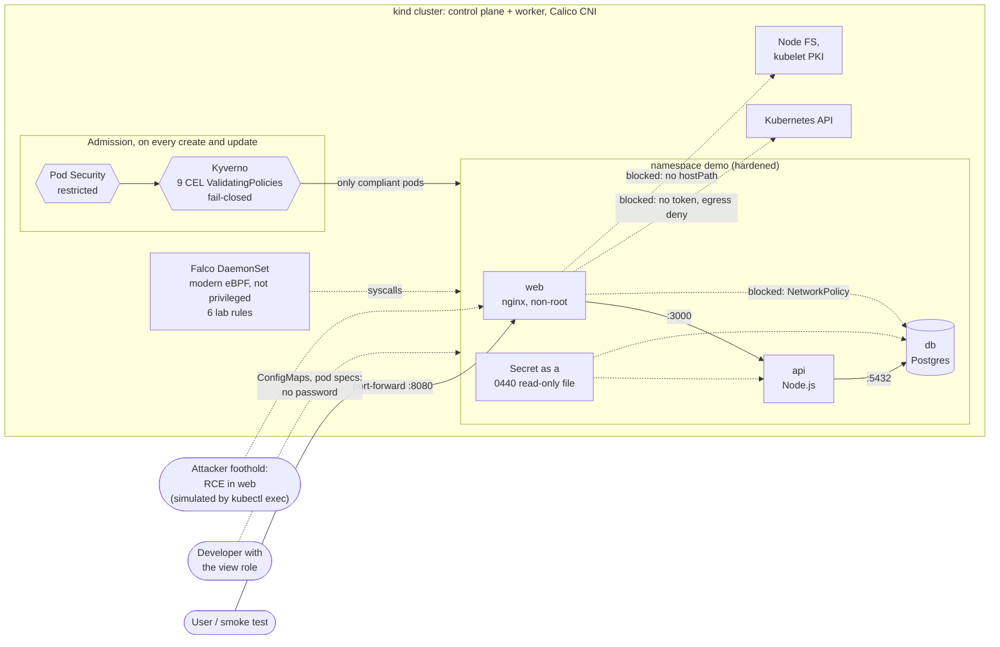

# k8s-attack-defense-lab

[](https://github.com/vladyslav-krutii/k8s-attack-defense-lab/actions/workflows/ci.yml)


**One app, deployed twice: once with six common Kubernetes
misconfigurations that I exploit, and once hardened so that every one of
those attacks is blocked, enforced at admission and detected at runtime.**

The app is a small three-tier service (nginx `web` → Node.js `api` →
Postgres `db`). The **vulnerable** overlay adds a privileged pod, an
over-permissive ServiceAccount, no NetworkPolicy, a password in a
ConfigMap, a writable root filesystem without limits, and mutable image
tags. The **hardened** overlay is the same app with six defense layers. It
keeps working end to end.

Every scenario has a `verify.sh` that runs the real attack path and exits
`0` exploitable, `1` blocked or `2` inconclusive. "It is fixed" is
therefore a test result, not a claim. CI rebuilds the whole lab on kind on
every push and requires **6/6 exploitable** on vulnerable and **6/6
blocked** on hardened. Kyverno CEL policies stop the misconfigurations
from coming back, and six custom Falco rules detect the attacks, including
the gaps that prevention cannot close.

> Runs only on a local [kind](https://kind.sigs.k8s.io/) cluster: no real
> targets, no public exposure. The demos show impact minimally (a masked
> password, a Secret's name, a marker file) and are not destructive.

## Scenarios

| # | Misconfiguration (vulnerable) | Attack → impact | Blocked in hardened by | Detected by (Falco) | Verify |
|---|---|---|---|---|---|
| 1 | [`privileged: true`, root, node `/` as `hostPath`](scenarios/01-privileged-hostpath/) | RCE in web → read the node FS and kubelet PKI (escape to host) | **PSA `restricted`** + securityContext; Kyverno `disallow-privileged-containers`, `disallow-host-path`, `require-run-as-nonroot` | rule 2 *credentials read* (kubelet PKI); rule 1 *shell without terminal* | `make verify-1` |
| 2 | [SA bound to `edit`, token auto-mounted](scenarios/02-rbac-sa-token/) | stolen token → `GET` every Secret in the namespace (HTTP 200) | **RBAC/identity**: own SA per workload, no token, no RoleBinding; egress policy without the API server | rule 2 (token read); rule 3 *unexpected outbound* (web → API server) | `make verify-2` |
| 3 | [no NetworkPolicy](scenarios/03-no-networkpolicy/) | web → `db:5432` directly, bypassing the api | **NetworkPolicy** default-deny + web→api→db, DNS (Calico) | rule 3 (web → db) | `make verify-3` |
| 4 | [password in a ConfigMap and in env vars](scenarios/04-secrets-in-env/) | a `view` user reads it from the ConfigMap / pod spec; `printenv` in api and db | **Secrets as files**: read-only volume, mode 0440 + `fsGroup`, `*_FILE` env; Kyverno `disallow-secrets-in-env`, `disallow-secrets-in-configmaps` | rule 4 *process environment read* | `make verify-4` |
| 5 | [root, writable root FS, no limits](scenarios/05-root-rw-nolimits/) | drop a tool into `/usr/local/bin` and run it; no CPU/memory ceiling | **Runtime limits**: `readOnlyRootFilesystem`, emptyDir with `sizeLimit`, requests/limits; Kyverno `require-readonly-rootfs`, `require-resource-limits` | rule 5 *write below binary dir*; rule 6 *exec from writable dir* | `make verify-5` |
| 6 | [images by mutable tag (`api:latest`)](scenarios/06-mutable-image-tag/) | re-pushed tag → a tampered image runs after a restart, no change in git | **Supply chain**: every image `name:tag@sha256:…`; Kyverno `require-image-digest`, `disallow-latest-tag` | none: no runtime signal (admission only) | `make verify-6` |

Each scenario README has the foothold, MITRE ATT&CK and Kubernetes threat
matrix mapping, the fix, the detection, and **what the fix does not
cover**. The residual risks are collected in the
[threat model](docs/THREAT_MODEL.md#accepted-risks-and-known-limits).

## Architecture



The vulnerable overlay is the same picture with every dotted "blocked"
edge open. The overlays share one [`k8s/base/`](k8s/base/). Each
`patches/` file in
[`overlays/vulnerable`](k8s/overlays/vulnerable/) and
[`overlays/hardened`](k8s/overlays/hardened/) maps to one scenario or one
layer.

## Defense layers (hardened overlay)

| Layer | What | Where |
|---|---|---|
| 1 Pod Security | PSA `restricted` (enforce pinned to v1.36, warn/audit `latest`); non-root, no privilege escalation, drop `ALL`, `RuntimeDefault` seccomp | [`namespace-psa.yaml`](k8s/overlays/hardened/namespace-psa.yaml), [`*-security.yaml`](k8s/overlays/hardened/patches/) |
| 2 Identity & RBAC | one ServiceAccount per workload, `automountServiceAccountToken: false`, no RoleBindings | [`serviceaccounts.yaml`](k8s/overlays/hardened/serviceaccounts.yaml), [`identity.yaml`](k8s/overlays/hardened/patches/identity.yaml) |
| 3 Network | default-deny ingress and egress; only web → api → db and DNS (enforced by Calico) | [`networkpolicies.yaml`](k8s/overlays/hardened/networkpolicies.yaml) |
| 4 Secrets as files | no credentials in env vars or ConfigMaps; read-only Secret volume, mode 0440 | [`secrets-as-files.yaml`](k8s/overlays/hardened/patches/secrets-as-files.yaml) |
| 5 Runtime limits | read-only root FS, explicit emptyDirs with `sizeLimit`, CPU/memory requests and limits | [`runtime-limits.yaml`](k8s/overlays/hardened/patches/runtime-limits.yaml) |
| 6 Supply chain | every image as `name:tag@sha256:digest`; the local api digest is resolved from the nodes at deploy time | [`render-pinned.sh`](scripts/render-pinned.sh) |
| Admission | **Kyverno 1.20**, 9 `ValidatingPolicy` (CEL), each in an audit and an enforce variant chosen by the namespace label `lab/kyverno`: audit in vulnerable, enforce in hardened. Offline `kyverno test`: 105 cases | [`policies/kyverno/`](policies/kyverno/) |
| Detection | **Falco 0.45** with `modern_ebpf` and four capabilities (not privileged), `rule_matching: all`, six custom rules with named exceptions | [`detection/falco/`](detection/falco/) |

Why each layer and what it costs: [`docs/design-decisions.md`](docs/design-decisions.md).

## Results

All numbers below are from CI run
[44936598909](https://github.com/vladyslav-krutii/k8s-attack-defense-lab/actions/runs/44936598909)
on `cf3d21c` (2026-11-21), the e2e and static jobs.

**`scripts/verify-all.sh`** (e2e job):

| Scenario | vulnerable (`--expect exploitable`) | hardened (`--expect blocked`) |
|---|---|---|
| 1 privileged + hostPath | EXPLOITABLE: web reads the node FS of `k8s-lab-worker` | BLOCKED: no node access; admission rejects it (`restricted:v1.36`) |
| 2 RBAC + token | EXPLOITABLE: web's token reads `db-credentials` (HTTP 200) | BLOCKED: no token mounted |
| 3 no NetworkPolicy | EXPLOITABLE: web reaches `db:5432` | BLOCKED: web → db refused while web → api works |
| 4 secrets in env | EXPLOITABLE: password via `view`, in api and db env | BLOCKED: only in the Secret and its file; api still connects |
| 5 root / rw / no limits | EXPLOITABLE: root, writable FS, no limits (all three apps) | BLOCKED: non-root, read-only FS, limits (all three) |
| 6 mutable tags | EXPLOITABLE: all three images by tag; tag-only admitted | BLOCKED: all pinned by digest; tag-only rejected |

**`make verify-detection`** (alert counts per rule, same run):

| Falco rule | vulnerable | hardened | Why on hardened |
|---|---|---|---|
| 1 shell without terminal | fire (12) | fire (8) | `pods/exec` and the shell still exist: correct alert |
| 2 Kubernetes credentials read | fire (5) | silent | no token, no hostPath |
| 3 unexpected outbound from web | fire (5) | silent | blocking `connect()` dropped by the policy |
| 4 process environment read | fire (1) | fire (1) | the read itself is reconnaissance |
| 5 write below binary dir | fire (1) | silent | EROFS |
| 6 exec from writable dir | fire (1) | fire (1) | `/tmp` emptyDir: the residual risk of scenario 5 |

Both overlays also pass the false-positive windows: no lab alert during
the app's start-up and during normal traffic (`smoke.sh`).

**Other gates** (same run): `make verify-admission` 15/15 (Kyverno alone,
in a namespace without PSA); `make reports` 8 PASS / 0 FAIL on every
hardened workload; `make policy-test` 105/105; kubeconform 63/63 resources;
`trivy config` hardened 0 MEDIUM+ findings and vulnerable 11 HIGH; api
image 0 fixable HIGH/CRITICAL, scanned by digest.

### How to read it

- **Exit codes.** `0` EXPLOITABLE, `1` BLOCKED, `2` INCONCLUSIVE. Every
  `verify.sh` first runs a **control** (for example web → api must work
  before a failed web → db counts as blocked), so a broken app never looks
  like a working defense.
- **What is simulated.** `kubectl exec` stands in for RCE in a container.
  `kind load` stands in for a registry push in scenario 6. The `view` user
  of scenario 4 is impersonated (`--as-group=lab:developers`).
- **Out of scope.** Control-plane hardening (etcd encryption, API server
  flags), node OS hardening, cloud IAM, real registries and image
  signatures (planned), multi-tenant clusters.

## Quickstart

Requirements: Docker, kind, `make` and bash (Linux or WSL2).
`make helm kubectl kyverno-cli` installs pinned,
checksum-verified tools into `~/.local/bin`.

```bash
make cluster kyverno policies falco     # kind + Calico, Kyverno + policies, Falco

make vulnerable                         # deploy the misconfigured app (fresh namespace)
make verify-detection                   # Falco rules: run FIRST, right after a deploy
make smoke                              # web -> api -> db works
bash scripts/verify-all.sh --expect exploitable
make scenario-2                         # one attack demo, step by step

make hardened                           # the same app with the defense layers
make verify-detection && make smoke
bash scripts/verify-all.sh --expect blocked

make policy-test verify-admission reports
make help                               # every target
```

`make verify-detection` measures a start-up window from the namespace
creation, so it has to run before anything else execs into the pods. The
scripts' own exit codes (0/1/2) are lost through `make`: call the script
directly when the code matters.

**Windows (PowerShell + WSL2).** The lab was built on Windows 11 with
Docker Desktop and a Kali WSL2 distro.

- Docker Desktop must be running (with WSL integration), because the kind
  nodes are its containers.
- Run `make` inside WSL from the repo on the Windows drive (`cd
  /mnt/c/Users/<you>/k8s-attack-defense-lab`). The `kind-k8s-lab` context
  lives in the WSL kubeconfig, not in the Windows one.
- From PowerShell, call a script file instead of an inline one-liner,
  because PowerShell 5.1 mangles nested quotes and `$?`:

  ```powershell
  wsl -d kali-linux -e bash -lc 'cd /mnt/c/Users/<you>/k8s-attack-defense-lab && make smoke'
  ```

## CI

[`.github/workflows/ci.yml`](.github/workflows/ci.yml) runs on every push,
on pull requests and on demand. Every job calls the same make targets a
person runs locally.

| Job | What it proves | Local equivalent | Time |
|---|---|---|---|
| `static` | kustomize + kubeconform (strict), `kyverno test`, shellcheck, Falco rule compilation, gitleaks over the history, `trivy config` with **opposite gates**: hardened must be clean, vulnerable must still have HIGH findings | `make ci-static` | ~25 s |
| `image` | the api image pushed to a throwaway local registry and scanned with trivy **by digest**; CycloneDX SBOM kept as an artifact | `make scan-image` | ~45 s |
| `e2e` | the whole lab on kind (Calico, Kyverno, Falco): both overlays, `verify-detection`, `verify-all --expect exploitable / blocked`, smoke, `verify-admission`, `reports` | the quickstart sequence | ~5.5 min |

Hygiene: actions pinned by commit SHA, tools by version and SHA-256,
images by digest, schemas by commit. `permissions: {}` at the workflow
level, `contents: read` per job, `persist-credentials: false`. Accepted
findings have a written reason in [`.trivyignore.yaml`](.trivyignore.yaml).

## Repository layout

```
k8s-attack-defense-lab/
├── app/api/              # the Node.js (TypeScript) api and its Dockerfile
├── cluster/              # kind config, Calico, Kyverno and Falco Helm values
├── k8s/                  # base + overlays/vulnerable + overlays/hardened (Kustomize)
├── policies/kyverno/     # 9 CEL ValidatingPolicies, audit/enforce, offline tests
├── detection/falco/      # 6 custom rules + README
├── scenarios/0N-*/       # README, run.sh (demo), verify.sh (0/1/2) per scenario
├── scripts/              # verify-all, verify-admission, verify-detection, scans, installers
├── docs/                 # threat model, interview notes, design decisions, log
└── .github/workflows/    # CI: static, image, e2e on kind
```

## Documentation

| Document | For |
|---|---|
| [docs/THREAT_MODEL.md](docs/THREAT_MODEL.md) | STRIDE per trust boundary: threat → control → where → how verified; accepted risks |
| [docs/design-decisions.md](docs/design-decisions.md) | trade-offs: non-privileged Falco, fail-closed webhooks with infra exclusions, … |
| [detection/falco/README.md](detection/falco/README.md) | the six rules, expected matrix, things that bit us |
| [policies/kyverno/](policies/kyverno/) | the policies and their tests |
| [docs/INTERVIEW.md](docs/INTERVIEW.md) | project story, debugging stories, Q&A, demo script (Ukrainian) |
| [docs/LEARNING.md](docs/LEARNING.md) | study log for every commit (Ukrainian) |
| [docs/NEXT.md](docs/NEXT.md) | current state, full re-check commands, optional extensions |
