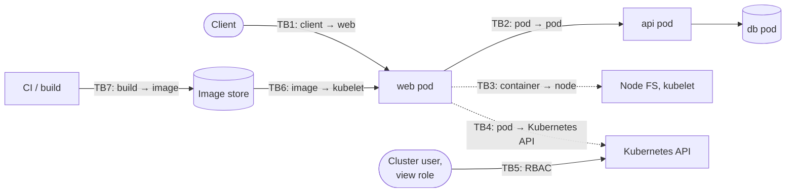

# Threat model

Scope: the lab's demo app (`web` → `api` → `db`) in its **hardened**
overlay, the cluster controls around it (Pod Security, RBAC,
NetworkPolicy, Kyverno, Falco), the api image and the CI pipeline, as of
2026-11-22. The vulnerable overlay is the "before" picture: each scenario
in it is one threat below with its controls removed.

Method: STRIDE per trust boundary. Each control names where it is
implemented and **how it is verified**:

- a `verify-N` scenario check (exit `0` exploitable / `1` blocked / `2`
  inconclusive, always after a positive control);
- a `make verify-admission` case (a dry-run pod that Kyverno alone must
  deny, in a namespace without PSA);
- an offline `kyverno test` case (`make policy-test`);
- a `make verify-detection` row (a Falco rule must fire or stay silent);
- a CI job (`static`, `image`, `e2e`).

All of these run in CI on every push. Numbers quoted here come from run
[44936598909](https://github.com/vladyslav-krutii/k8s-attack-defense-lab/actions/runs/44936598909).
"Review only" means nothing automated checks it.

## System and trust boundaries

| Asset | Why it matters |
|---|---|
| The database password (`db-credentials`) and the data in `db` | the business data; the password opens it bypassing the api |
| The node and its kubelet credentials (`/var/lib/kubelet/pki`) | owning the node means owning every pod on it and talking to the API server as the kubelet |
| The Kubernetes API (ServiceAccount tokens, Secrets) | read Secrets, change workloads, persist |
| The images that run (by tag or by digest) | whoever controls them runs code in the cluster |
| The controls themselves (Kyverno, Falco, CI) | turning one off silently removes a layer |
| Node CPU and memory | shared by every pod on the node |

| Attacker position | How the lab simulates it | Scenarios |
|---|---|---|
| Code execution in `web` (the internet-facing tier) | `kubectl exec deploy/web -- …` | 1, 2, 3, 5 |
| A cluster user with the built-in `view` role | impersonation, `--as-group=lab:developers` | 4 |
| Push access to an image name (leaked registry token, compromised CI, hijacked upstream) | `docker build` + `kind load` under the same tag | 6 |
| A commit to the repository | a pull request through CI | CI gates |

## Threats and controls

Links: overlays in [`k8s/overlays/`](../k8s/overlays/), policies in
[`policies/kyverno/base/`](../policies/kyverno/base/), Falco rules in
[`detection/falco/lab-rules.yaml`](../detection/falco/lab-rules.yaml),
checks in [`scripts/`](../scripts/) and [`scenarios/`](../scenarios/), CI
in [`ci.yml`](../.github/workflows/ci.yml).

### TB3: container → node

| # | STRIDE | Threat | Control | Where | Verified by |
|---|---|---|---|---|---|
| N1 | **E** | **Escape to host** through `privileged: true` + `hostPath: /` (scenario 1, ATT&CK T1611) | PSA `restricted` (enforce pinned to v1.36); securityContext: non-root, `allowPrivilegeEscalation: false`, drop `ALL`, `RuntimeDefault` seccomp; Kyverno `disallow-privileged-containers`, `disallow-host-path` | `namespace-psa.yaml`, `patches/*-security.yaml` | `verify-1` BLOCKED (admission rejects, `restricted:v1.36`); `verify-admission`: scenario 1 pod, privileged only, hostPath only → DENIED by Kyverno; `kyverno test` |
| N2 | E | Container runs as **root**, so any write or kernel bug starts from uid 0 | `runAsNonRoot`, explicit uids; Kyverno `require-run-as-nonroot` | `patches/*-security.yaml` | `verify-5` reads the uid in all three pods; `verify-admission`: runs as root → DENIED |
| N3 | **T** | **Tool dropped into the image FS** and run, or persistence (scenario 5, T1105) | `readOnlyRootFilesystem: true`; only explicit emptyDirs are writable (web `/tmp`, db socket dir and data); Kyverno `require-readonly-rootfs` | `runtime-limits.yaml` | `verify-5` reads `ro` in `/proc/mounts`; `verify-admission`: writable root FS → DENIED; Falco rule 5 *write below binary dir* fires on vulnerable, silent on hardened (EROFS) |
| N4 | T | Dropped tool **executed from the writable emptyDir** (`/tmp`) | not prevented (see accepted risks); **detected** by Falco rule 6 *exec from writable dir* | `lab-rules.yaml` | `verify-detection`: rule 6 fires on both overlays (1 alert each) |
| N5 | **D** | **Resource exhaustion**: one pod takes the node's CPU or memory (T1496, T1499) | requests and limits on every container; `sizeLimit` on every emptyDir; Kyverno `require-resource-limits` (enforce) | `runtime-limits.yaml` | `verify-5` reads cgroup `memory.max` / `cpu.max`; `verify-admission`: no limits → DENIED |
| N6 | I | Node credentials read (kubelet PKI, other pods' tokens under `/var/lib/kubelet/pods`) | no hostPath (N1) | as N1 | Falco rule 2 *credentials read* fires on vulnerable (scenario 1), silent on hardened |

### TB4 / TB5: the Kubernetes API

| # | STRIDE | Threat | Control | Where | Verified by |
|---|---|---|---|---|---|
| A1 | **I** / E | **Stolen ServiceAccount token** reads every Secret (scenario 2, T1552.007) | one ServiceAccount per workload, `automountServiceAccountToken: false`, no RoleBinding | `serviceaccounts.yaml`, `patches/identity.yaml` | `verify-2` BLOCKED (no token mounted); Falco rule 2 fires on the token read on vulnerable |
| A2 | E | Over-permissive role (`edit`) lets a workload change Deployments or `exec` into other pods (persistence, lateral movement) | no RoleBindings for workloads; if one is needed, a Role with named resources | as A1 | `verify-2`; scenario 2 `run.sh` lists `auth can-i --list` |
| A3 | I | Pod reaches the API server over the network even without a token (discovery, anonymous endpoints) | egress default-deny; web may reach only api and DNS | `networkpolicies.yaml` | Falco rule 3 fires on web → `10.96.0.1:443` on vulnerable; silent on hardened (blocking connect dropped) |
| A4 | **I** | **Password in a ConfigMap or pod spec**, readable with the `view` role and printed by `kubectl describe` (scenario 4, T1552.001) | credentials only in a Secret (which `view` cannot read); Kyverno `disallow-secrets-in-configmaps`, `disallow-secrets-in-env` (literal values) | `secrets-as-files.yaml` | `verify-4` as `lab:developers`; `verify-admission`: ConfigMap with `PGPASSWORD`, literal env password → DENIED; trivy KSV-0109 is one of the 11 HIGH findings that must stay in vulnerable |
| A5 | I | **Password in env vars** (even from `secretKeyRef`): `/proc/<pid>/environ`, `printenv`, child processes, crash dumps (scenario 4) | Secret as a read-only volume, mode 0440 + `fsGroup`, apps read `*_FILE`; Kyverno denies `secretKeyRef` env | `secrets-as-files.yaml`, `app/api/src/server.ts` | `verify-4` (`printenv` in api and db, compared against the real Secret value; control: api `/readyz`); `verify-admission`: Secret as env var → DENIED, `*_FILE` path → ADMITTED; Falco rule 4 fires on `/proc/1/environ` reads |

### TB1 / TB2: network

| # | STRIDE | Threat | Control | Where | Verified by |
|---|---|---|---|---|---|
| W1 | **E** / I | **Lateral movement** from web straight to `db:5432`, bypassing the api (scenario 3, T1046) | default-deny ingress and egress; allows only web → api:3000, api → db:5432, DNS; enforced by Calico | `networkpolicies.yaml` | `verify-3` BLOCKED while the control web → api works; `make verify-netpol` proves Calico enforces (allow → deny → allow); Falco rule 3 fires on vulnerable |
| W2 | I | Exfiltration or C2 from web to anything else | egress deny (W1); detection of every unexpected TCP connect from web | `lab-rules.yaml` | `verify-detection` rule 3; false-positive window: no alert during `smoke.sh` traffic |
| W3 | S | The app is exposed outside the host | `web` Service is ClusterIP only; access via `kubectl port-forward` | `k8s/base/web.yaml` | review only |

### TB6 / TB7: images, build and CI

| # | STRIDE | Threat | Control | Where | Verified by |
|---|---|---|---|---|---|
| C1 | **T** / S | **Mutable tag re-pointed**: a tampered image runs after a restart, with no change in git (scenario 6, T1525, T1195.002) | every image as `name:tag@sha256:digest`; local api digest resolved from the nodes by `render-pinned.sh` (fails if nodes disagree); Kyverno `require-image-digest` (64 hex, init and ephemeral containers too), `disallow-latest-tag` | `kustomization.yaml` `images:`, `scripts/render-pinned.sh` | `verify-6` (dry-run: tag-only denied, pinned control admitted); `verify-admission`: `latest`, no tag, version tag without digest → DENIED; `kyverno test` (short digest rejected) |
| C2 | T | Known-vulnerable packages shipped in the api image | multi-stage build; npm, npx, corepack, yarn removed from the runtime stage | `app/api/Dockerfile` | `image` job: trivy on the **pushed digest**, fails on fixable HIGH/CRITICAL (0 in run 44936598909); CycloneDX SBOM artifact |
| C3 | T | Insecure or invalid manifests merged | kubeconform `-strict` on every kustomization; `trivy config` **opposite gates**: hardened 0 MEDIUM+, vulnerable must keep HIGH findings | `scripts/lint-manifests.sh`, `scripts/scan-config.sh` | `static` job: 63/63 valid; hardened clean; vulnerable 11 HIGH |
| C4 | T | A policy change silently stops denying | offline `kyverno test` with good and bad fixtures for every policy | `policies/kyverno/tests/` | `static` job: 105/105 |
| C5 | T | A Falco rule change breaks the ruleset or a rule goes quiet | rules compiled with the pinned Falco image; detection matrix tested on a live cluster | `make falco-validate`, `scripts/verify-detection.sh` | `static` job; `e2e` job, both overlays |
| C6 | I | Secrets committed to the repository | gitleaks over the full history | `make secrets-scan` | `static` job |
| C7 | T | Compromised third-party action, tool or image (moved tag) | actions pinned by commit SHA; tools by version + SHA-256; Falco, registry, busybox images by digest; schemas by commit | `ci.yml`, `scripts/install-ci-tools.sh` | installers fail on a checksum mismatch in every CI run; pins: review only |
| C8 | E | A CI step abuses the token (push, change releases) | `permissions: {}` at workflow level, `contents: read` per job, `persist-credentials: false` | `ci.yml` | review only |
| C9 | R | "It works on my machine": a check passed once by accident | the whole lab rebuilt from zero on kind in CI on every push, both overlays | `e2e` job | `verify-all` 6/6 both ways in run 44936598909 |

### The controls themselves

| # | STRIDE | Threat | Control | Where | Verified by |
|---|---|---|---|---|---|
| P1 | T / D | Kyverno down → policies silently skipped | webhooks `failurePolicy: Fail` (fail-closed) | `cluster/kyverno/values.yaml` | review only; see the single-replica risk below |
| P2 | E | Workload created in a namespace Kyverno does not check | infra namespaces excluded only because RBAC limits who can create pods there; lab policies select only namespaces labelled `lab/kyverno` | `cluster/kyverno/values.yaml`, [`design-decisions.md`](design-decisions.md) | `auth can-i` loop in design-decisions (manual): `no` for every demo ServiceAccount |
| P3 | E | Compromised runtime sensor owns the node | Falco with `modern_ebpf` and four capabilities, not privileged; rule auto-update (`falcoctl follow`) off | `cluster/falco/values.yaml` | review only |
| P4 | R | A detection rule is **shadowed** by a stock rule that matched first | `rule_matching: all` | `cluster/falco/values.yaml` | `verify-detection`: rule 3 fires on web → API server, the event the stock rule used to swallow |
| P5 | R | Noisy rules get ignored | narrow rules with named exceptions (runc, `initdb`, PID 1 entrypoint, musl resolver UDP connects); TCP-only outbound rule | `lab-rules.yaml` | `verify-detection`: no lab alert during start-up and normal traffic, both overlays |
| P6 | D | Kyverno reports controller stalls at its memory limit (leader lease lost, exit 0) | limit raised 128Mi → 512Mi | `cluster/kyverno/values.yaml` | `e2e` job `make reports`: 8 PASS / 0 FAIL per hardened workload |

## Accepted risks and known limits

| Item | Risk | Why accepted / mitigation | Revisit |
|---|---|---|---|
| **Exec from `/tmp` on emptyDir** | a tool dropped into the writable emptyDir still runs; Kubernetes cannot mount an emptyDir `noexec` | web (nginx) needs `/tmp`; Falco rule 6 alerts on it; the stock "Drop and execute new binary" rule misses it (it only sees the overlay upper layer) | distroless or shell-less images; a `noexec` CSI volume |
| **Rule 1 (shell without terminal) fires on hardened** | by design, not a false positive | pod hardening does not remove the shell from the nginx image or an admin's `pods/exec`, so the shell really runs | distroless image; restrict `pods/exec` by RBAC |
| Rule 4 fires on hardened | by design | reading another process's environment is reconnaissance whether or not it still holds a password | — |
| Rule 3 fires on hardened for **non-blocking** connects | `curl`/Node get `EINPROGRESS` before the policy drops the packet, so a blocked attempt still alerts | intended: an attempt to leave web is a compromise signal | — |
| Rule 3 counts TCP only | UDP egress from web is not detected | musl's `getaddrinfo()` `connect()`s UDP sockets without sending a packet, which produced misleading alerts; UDP egress is left to the default-deny policy | Calico flow logs |
| **Image signature verification deferred** | a digest proves *what* runs, not *who* built it | `kind load` has no registry to hold a Cosign signature; KSV-0125 accepted with this reason in `.trivyignore.yaml` | scenario 7 (SecScan, signed in its CI, from GHCR) or a local registry + Cosign |
| **Kyverno: single admission replica**, fail-closed | an outage blocks new pods in labelled namespaces | correct direction for a lab ("no decision, no admission"); infra namespaces excluded to avoid the Calico deadlock | production: ≥3 replicas, PDB, availability alerts |
| **Excluded infrastructure namespaces** | `kube-system`, `calico-system`, `tigera-operator`, `local-path-storage`, `kyverno`, `falco` are not checked by Kyverno (nor PSA in kind) | creating workloads there is limited to cluster admins by RBAC; Falco stock rules still watch every namespace | — |
| Lab Falco rules cover only `demo` | app-specific rules do not apply to other namespaces | they encode `demo`'s architecture (web → api only); stock rules cover the rest | generalize rule 3 for SecScan in scenario 7 |
| **`kubectl port-forward` bypasses NetworkPolicy** | checked on 2026-11-22 on hardened: in-cluster web → `db:5432` BLOCKED, while `kubectl port-forward deploy/db 15432:5432` reached Postgres | the kubelet enters the pod's network namespace; the traffic never crosses the pod network, so the policy never sees it. Access is an RBAC question: `pods/portforward` (`auth can-i` for `lab:developers`: `no`) | — |
| The app user can read its own secret file | code execution as the api user still reads the password | inherent: the app needs it; 0440 keeps other users out, no env copies | dynamic, short-lived DB credentials (Vault) |
| Ephemeral containers (`kubectl debug`) skip `require-readonly-rootfs` | a debug container can write | debugging usually needs to write; privileged/root/`latest` are still denied for `pods/ephemeralcontainers` | restrict `pods/ephemeralcontainers` by RBAC |
| PolicyReports are asynchronous | a report is not proof that an enforce policy blocks | proof of blocking is the admission denial (`verify-admission`); `make reports` waits for the background scan | — |
| Falco output contains command lines | secrets passed as arguments end up in logs | nothing in the lab passes secrets as arguments; log access is admin-only | — |
| Scenario 6 has no runtime detection | a tampered image behaves like the genuine one at syscall level | covered at admission (digest) and belongs to the registry (immutable tags, push audit) | — |
| PSA `enforce-version` pinned to v1.36 | a cluster upgrade does not tighten enforcement by itself | deliberate: an upgrade must not break the deploy; `warn`/`audit` at `latest` show new violations in advance | on each Kubernetes minor upgrade |
| Builds are not byte-reproducible across machines | the CI digest differs from the local one | every scan and pin names the exact digest it checked | reproducible builds (SOURCE_DATE_EPOCH, pinned base) |
| LOW `trivy config` findings are printed, not gated | e.g. UID > 10000 suggestions | the gate is MEDIUM+ for hardened | — |
| Out of scope | control plane (etcd encryption, API server flags, audit policy), node OS, cloud IAM, multi-tenancy, real registries | a local single-tenant kind lab | — |
